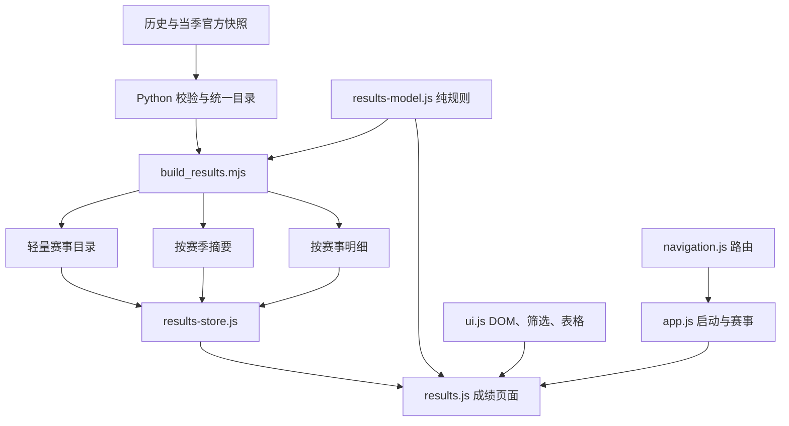

# 成绩模块与数据契约

更新：2026-10-28。前端仍为原生 JS，无运行时第三方依赖。Playwright/jsdom 仅用于开发验证。

## 模块职责

| 模块 | 唯一职责 | 不承担 |
|---|---|---|
| `tools/history_data.py` | 校验身份、来源、既有统计范围；合并历史与当季记录 | 页面统计和 DOM |
| `web/results-model.js` | 纯成绩模型、指标、运动员贡献、项目状态与覆盖判断；构建与浏览器共用 | 网络、DOM、当前时间 |
| `tools/build_results.mjs` | 从已校验的统一目录生成目录、赛季摘要与逐赛事明细 | 抓取或推算缺失成绩 |
| `web/results-store.js` | 目录／摘要／明细请求、按文件缓存、最多 4 个并发、失败清缓存后重试、数据版本验证 | 统计定义与 DOM |
| `web/results.js` | 成绩检索、档案、回顾和对比页面；管理筛选和视图状态 | 重复指标算法或上游抓取 |
| `web/ui.js` | 安全 DOM、select、URL 筛选序列化、可聚焦表格滚动容器 | 业务数据 |
| `web/navigation.js` | 四栏目与新旧地址解析 | 成绩查询 |
| `web/portal.js` | 首页与运动员目录 | 成绩渲染或成绩统计 |
| `web/app.js` | 启动、赛事赛程／名单／分组详情与既有时钟逻辑；通过接口进入业务页 | 历史成绩统计 |
| `tools/build.py` | 编排导出、静态深链接、脚本清单、PWA 外壳版本 | 前端指标算法 |

保留赛事页内部已有赛程、分组和报名逻辑，避免在历史成绩整改中同时改动其异步 API 生命周期；其行为由原有测试继续覆盖。本轮的模块边界是可单测的数据模型／仓库与页面查询接口，而不是按行数拆文件。

## 输出契约

所有相对路径均相对于 `/data/`。新投影 `schema_version=2`，目录检索契约 `search_version=1`；原有完整导出继续提供，以保留已有直接数据链接。

| 文件 | 契约与用途 |
|---|---|
| `results/index.json` | `country`、`statistics_scope`、`current_season`、`cycles`、`athletes`、`events`、`pending`、精简 `inventory`。`events` 是无成绩行、无来源 documents 的元数据，含 `official_event_id`、`programme`、`coverage_detail`、`record_count`、`detail_file`；顶层 search_file 指向检索索引 |
| `results/search.json` | 按赛事保存逐行 `search_rows` 投影，只有姓名／性别／距离筛选时读取；无名次、来源、指纹或阵容明细 |
| `results/seasons/YYYY-YY.json` | `{schema_version, season, items:[{id, summary}]}`。每个 summary 含 totals、9 个 projects 与 athlete 贡献摘要。只在回顾／对比选中该季时读取 |
| `results/events/<id>.json` | 完整赛事：元数据、programme、原始 results、完整 source。保留 PDF 页码／指纹和 API documents/form/响应指纹；记录不回填、不推算 |
| `results.json` | 保留原有全目录导出及其地址；新页面不请求它。原 source 补充完整 documents 引用，成绩行与统计口径不变 |
| `history/index.json`、`data/history/events/*` | 原档案和证据来源保持；不作为成绩页面首屏数据 |

摘要由同一 `summarize` 生成，页面通过 `statistics` / `projectSummary` 聚合，不在各页重新实现奖牌、A 决赛、前八或贡献算法。`summary.best` 仅投影显示所需字段；需要来源或实际接力成员时读取明细。

检索索引 `search_rows` 是逐成绩行的投影：`{gender, distance_m, names}`。`names` 按身份保存原始姓名、登记姓名与别名，接力只索引该场明细已有成员，另含“中国队”队名；不从当前名单回填成员，不自行翻译或新增中文姓名。重复投影可以去重，因为分页只需要判断赛事中是否存在匹配行。

构建和最终明细过滤都通过 results-model 的 `resultSearchRow` / `resultFilter` / `matchesResultSearch`；目录候选判断 `eventMatchesResults` 使用同一谓词。姓名做 NFKC、大小写和空白归一化；所有词必须命中同一身份，可忽略英文名姓顺序，不能跨不同行或不同接力队员拼出不存在的名字。支持数据中已经登记的中文名与别名；当前官方历史身份表没有中文个人别名，中文算法由明确的测试夹具验证，不编造翻译。

总览、回顾、对比及未启用行级筛选的列表只读取原目录，不预取检索投影。行级筛选时由仓库按文件缓存读取一次 search.json，再执行赛季、周期、赛事类型和逐行组合条件匹配，按每页最多4场分页；只有当前页才请求明细。没有姓名／性别／距离限制时保留已确认的零记录赛事；有行级限制时无匹配赛事不占分页位置。明确选择某赛事时保留其头部并显示“所选赛事没有符合条件的成绩”，跨赛事搜索为空则显示“没有匹配的赛事”。不为计算页数读取全部赛事明细。超范围页码归一到有效末页并写回 URL。

目录缺少 search_version/search_file、或检索索引缺少 search_rows 时拒绝使用并允许重试，不对旧版本目录做可能产生假匹配的兼容推断；不回退全量 JSON。

## 状态不能互换

| 状态 | 证据 | 显示 |
|---|---|---|
| `uncollected` | 官方目录／最终分类范围尚不能确认，或期望赛事缺失 | 未收录；不把空值当作 0 |
| `not_offered` | 已确认完整范围内的全部正式 programme 均未设该项目 | 未设项 |
| `zero` | programme 已确认设项、赛事完整且无中国队记录，或明确 participation=none | 无中国队记录（0） |
| `recorded` + partial | 有记录，但目录、项目或最终分类未齐 | 已收录部分；缺最终分类就近标记 |
| `recorded` + complete | 选定官方范围与赛事记录均完整 | 正常显示已核实指标 |

赛事的 `coverage=complete` 不等于周期完整；scope 还必须核对官方 event IDs、pending、所有包含赛季的目录范围。无显式对应类型目录的赛季保守视为未知，包括未来赛季；不得仅从“导入数量相等”宣布完整。`programme=null` 表示未知，`programme=[]` 表示已核验空项目表，两者不同。

本轮不补抓四场缺失的最终分类。当季成绩目前尚缺完整 programme/最终分类范围确认，保留 partial，不把部分决赛记录用于完整当季或阿尔卑斯周期结论。

固定统计口径：个人 500/1000/1500 米及接力；排除全能和个人超级 3000；接力一队一次，阵容缺失不影响团队完整度；DNS 不计出赛；B 决赛冠军不计奖牌；当前官网正式最终分类优先，旧组内名次继续保留溯源。对比的“最佳名次”优先选有正式总排名的成绩；若所选范围内全部没有总排名，可展示证据明确的 A/B 决赛组内名次，必须带“A组”或“B组”标识，绝不能当作整站总排名跨赛事比较。缺失分类、部分覆盖和来源冲突等诊断保留于 JSON 与内部文档，不在用户页面输出解释徽标或待补提示。

## 页面和加载约定

四个一级栏目不变。周期包含赛季，赛季包含赛事。`/history/`、原 `/results/?view=history` 和原分站查询链接保持有效。赛事明细中的 event 优先恢复其所属周期和赛季，避免旧链接受当前默认季影响。

无范围的赛事列表默认 `current_season`，重置回到当前季；显式 `season=all` 必须保留在 URL。`page` 为从 1 开始的赛事页码，换条件回到第一页。输入搜索有 150ms 防抖。异步查询通过版本号阻止旧响应覆盖新条件。

回顾／对比首屏只读目录和选中赛季摘要；隐藏项目明细不创建 DOM。展开后按列、按周期第 1—4 季组织，每组最多加载 3 场并可前后翻组，滚动区域限制高度。每个明细区有独立请求版本号；翻组时冻结组号，关闭时失效、重开时按当前组重读缓存，切换对象立即使旧视图失效。成功、错误和 finally 都只允许当前且仍连接／展开的视图更新 DOM；过时请求保留在仓库中用于缓存，不取消其他视图共享的请求。手机双对象同屏，第三对象仅表格内部横向滚动，项目列固定；统计和贡献表的首列、表头固定。

构建以零依赖字符串拼接输出单个 site.js，源模块独立测试，旧脚本路径继续输出。PWA 外壳预缓存 site.js，版本由 `build.SHELL_FILES` 内容派生；访问过的目录、摘要及明细由原 network-first 策略缓存。离线不能访问尚未缓存的范围时显示错误及重试，不生成零统计。

## 后续改动入口

- **新增页面**：在 navigation.resolve 登记地址；在 results 业务或相应业务模块实现入口；在 build.py 的 page_paths 增加真实深链接 HTML；补路由、独立加载和筛选恢复测试。
- **新增指标**：只修改 results-model 的纯函数及 summary 契约，调整 results 页面显示；先用旧值对照和明确状态样例测试，再重新构建全部摘要。禁止在渲染函数内另写计数规则。
- **新增赛季**：修改 data/stations.json 与经过核实的历史 catalog/cycles/inventory；构建自动生成目录、摘要、页面。cycle 内可以包含未来季，未来季不得继承其他赛季完整度。若目录口径变化，更新本契约及 scope 测试。
- **新增模块**：在 build.SCRIPTS 的依赖顺序中登记；单一浏览器 bundle 和 PWA 版本自动包含它，测试确保源模块都进入产物。
- **修改来源/分类**：走现有导入与校验流程，保留指纹和 previous_final_result；不要在生成器或页面修补名次。

## 验证

常规：`npm ci --ignore-scripts`、`python -m pip install -r requirements.txt ruff==0.16.9`、`ruff format --check tools tests`、`ruff check tools tests`、`python tools/build.py`、`python -m unittest discover -s tests -v`、`node --test tests/*.mjs`。

浏览器：`npx playwright install --with-deps chromium --only-shell`，安装中文字体后运行 `node tools/verify_results_ui.mjs`。`QA_BASELINE` 可指定基线 dist 目录；`QA_OUT` 可指定报告目录；`PLAYWRIGHT_CHROMIUM_EXECUTABLE` 可指定本机已有 Chromium。报告使用真实数据、3 次独立上下文的本地中位数；不代表公网 4G 延迟。CI 保存截图和 JSON 测量为 `results-ui-verification` artifact。
