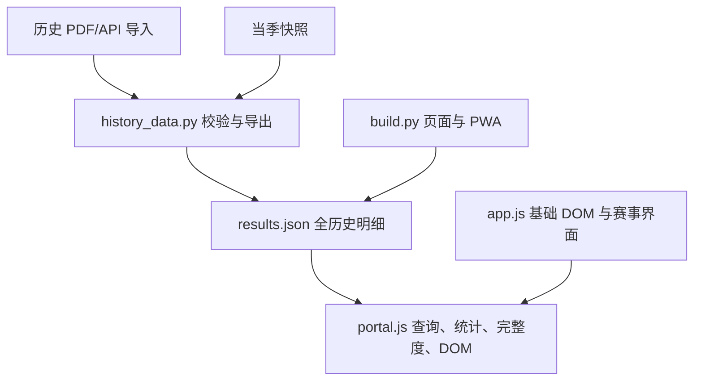

# PR #36 整改审计

基线：`79d920104b6c0dbd1b2554c2517809e2a850dbe6`，依赖 #35 的 `40f886f`。

## 重构前

- `history_data.py` 负责身份、官方来源校验、档案与当季合并；完整原始文件必须保留。
- `portal.js` 同时负责首页、目录、成绩检索、统计、覆盖判断和 DOM。各成绩页首屏均下载 1,582,415 字节的 results.json，索引页也不例外。
- 赛事列表默认全部历史，1,700 余行一起生成；对比页隐藏明细也预先生成。
- 统计计算多次扫描相同记录，项目状态根据已导入赛事推断，容易将缺失范围误作未设项或零。
- 当前赛事合并记录缺少 coverage/programme 元数据；部分周期的统计值缺少就近的局部范围标识。
- 构建复制脚本的清单、PWA 版本散列和缓存清单分别维护，有新增模块遗漏风险。
- Ruff 0.16.9 在两文件格式处失败，后续 CI 全部跳过。补齐依赖后基线为 Node 50/50；Python 93/94。失败用例仍期待旧分类冲突策略，与当前已确认的“采用官网正式最终分类”不一致。

## 渐进边界

1. 先修格式并保留独立提交。
2. 无 DOM 的统一成绩模型：指标、项目状态、覆盖范围、运动员贡献；用真实全历史对照既有统计。
3. 构建派生轻量索引与逐赛事明细；保留原始来源和旧导出，不请求它们作为首屏数据。
4. 数据仓库负责索引、缓存、并发与重试；页面只查询和渲染。事件列表默认当季、按页读取；原始成绩展开才读取。
5. 共享 DOM、筛选与表格基础组件；成绩业务独立于赛事赛程和运动员目录。
6. 最后验证路由、筛选、PWA 与 390/768/1440px 的真实数据布局。

所有状态/性能数字的最终验收结果另见整改报告；此文件记录实施前的判断，不代表验证通过。
